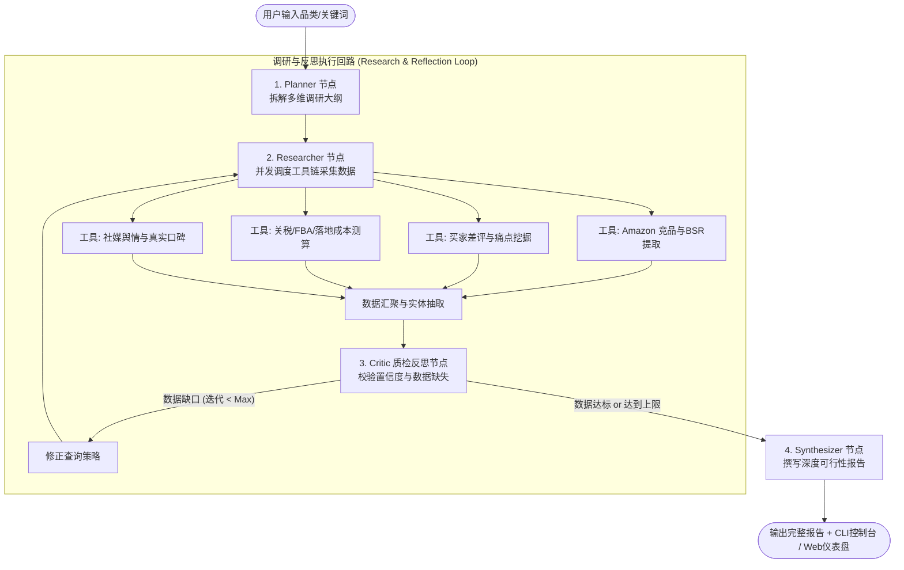

# 🚢 跨境电商垂直版 Deep Research AI Agent

> **Cross-Border E-Commerce Deep Research Agent**
> 基于 **LangGraph 状态机** 与 **NVIDIA NIM (Nemotron 550B)** 大模型，专为出海电商卖家、选品操盘手与供应链投资人打造的深度商业调研智能体。
> 
> 🌐 **在线体验 (Live Demo)**: [https://cross-border-e-commerce-2kxx7hfbiertguvimg48uy.streamlit.app/](https://cross-border-e-commerce-2kxx7hfbiertguvimg48uy.streamlit.app/)

---

## 🌟 核心特色与业务价值

与通用问答或简单包装的搜索 Bot 不同，本智能体内置跨境电商专属的“商业决策模型”与“反思质检回路”：

1. **自动任务分解（Planner）**：将一个品类（如 `Portable Camping Espresso Maker`）自主拆解为竞品分析、VOC逆向工程、落地毛利测算与社媒趋势四个独立维度。
2. **买家差评逆向工程（VOC Mining）**：聚类 1-3 星差评的核心涉事零部件、失效场景，并给出可直接交付给工厂的开模改良建议。
3. **真实商业测算引擎（Cost & FBA Calculator）**：按亚马逊最新标准精准划分 FBA 尺寸分段（Standard / Oversize），计算包装体积重（抛重）、海运拼箱 CBM 运费、美国 301 关税（25%）与平台佣金，输出真实的销售净利率与投资回报率（ROI）。
4. **状态质检反思循环（Critic Loop）**：评估当前数据丰度与利润门槛，若发现严重数据缺口，自动触发下一轮定向补缺搜索，否则才放行至最终报告撰写。
5. **结构化决策报告（Synthesizer）**：一键生成达到投委会/立项评审标准的深度商业可行性分析报告（支持 Markdown 与在线下载）。

---

## 🏗️ 架构设计 (LangGraph StateGraph)



---

## 🚀 快速启动指南

### 1. 环境准备
本项目使用现代 Python 包管理器 `uv` 进行依赖管理（Python >= 3.12）：
```bash
# 安装依赖
uv pip install -e .
```

### 2. 配置环境变量
项目已支持 NVIDIA NIM API（复用 `agent-workbench` 中的配置）：
```env
NVIDIA_API_KEY=your_nvapi_key_here
NVIDIA_BASE_URL=https://integrate.api.nvidia.com/v1
LLM_MODEL=nvidia/nemotron-3-ultra-550b-a55b
```

### 3. 运行方式

#### 方式 A：命令行运行（CLI 模式，带 Rich 终端流式输出）
```bash
uv run python -m deep_research.cli "Portable Camping Espresso Maker" --market US --max-iter 2
```

#### 方式 B：启动 Web 可视化工作台（Streamlit）
```bash
uv run streamlit run ui/app.py
```
在浏览器打开 `http://localhost:8501`，即可通过可视化仪表盘输入品类、实时观察状态流转，并在线阅读/下载完整的商业可行性报告。

---

## 🧪 单元测试与验证
```bash
uv run pytest
```
测试套件覆盖：
- `test_calculator.py`：验证 FBA 尺寸分段、抛重计算公式与关税利润模型精确性；
- `test_graph.py`：验证 LangGraph 状态机端到端全流程闭环执行。
